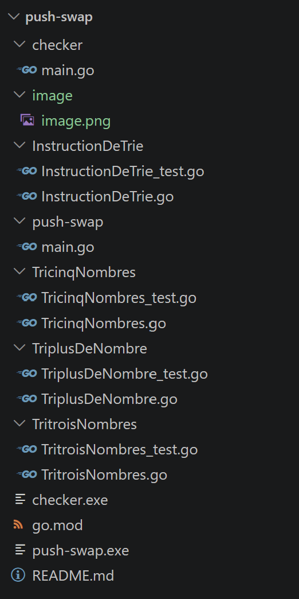

# push-swap

## Présentation du projet

le projet consiste à trier des nombres qui au départ sont rangés en déshordre et à partir de certaines instructions de trie les rangés de façon croissante.

## Fonctionnalités (programme push-swap)

-Récupérer les nombres entiers transmis en arguments.
-Accepter les nombres positifs et négatifs.
-Gérer les arguments contenant plusieurs nombres séparés par des espaces.
-Vérifier que les arguments sont des nombres entiers.
-Détecter les doublons.
-Afficher Error en cas d'entrée invalide.
-Détecter si la pile est déjà triée et ne rien faire dans ce cas.
-Choisir une méthode de tri selon le nombre de valeurs.
-Générer les instructions nécessaires pour trier la pile A.
-Chercher à limiter le nombre d'instructions.

## Fonctionnalités (programme checker)

-Recevoir les nombres initiaux de la pile A.
-Lire les instructions depuis l'entrée standard (stdin).
-Exécuter les instructions sur les piles A et B.
-Vérifier que les instructions sont valides.
-Vérifier que la pile A est triée à la fin.
-Vérifier que la pile B est vide à la fin.

## Technologies

-Go 
-Github 

## Prérequis

-Une version récente du langage Go.
-Un IDE comme visual studio code.

## Instalation

-télécharger le fichier ZIP du projet.
-Extrayez son contenu dans un dossier.
-ouvrez le dossier du projet dans un IDE compatiple avec Go.
-assurez-vous que Go est installé sur votre ordinateur.

## Lancement 

Après avoir ouvrie le dossier dans votre IDE, vous ouvrez le terminal de l'IDE et vous pouvez entrer ces differentes commande:
  - ./push-swap "vos nombres" puis taper entrer. Ensuite vous entrerez les instructions ci dessous qui vous semblerons être les plus juste pour ranger vos nombres.
  - ./checker "vos nombres" puis taper entrer. Ensuite vous entrerez les instructions ci dessous qui vous semblerons être les plus juste pour ranger vos nombres et vous verez s'ils sont rangés ok sinon ko s'ils ne le sont pas.
  - '','', | .\checker.exe "vos nombres" ('une instruction','une instruction') puis entrer et vous verez le resultat soit ok ou ko.
  - .\push-swap.exe "vos nombres" | .\checker.exe "vos même nombres" puis entrer et vous obtiendrez le resultat ko ou ok.
  - pour compter le nombre d'instruction qui on été utiliser pour ranger vos nombres (copier):
  $nombres = "vos nombres"
  (.\push-swap.exe $nombres | Measure-Object -Line).Lines
   - pour les deux en même temps vérifier et  compter copier:
   $nombres = "vos nombres"
   $instructions = .\push-swap.exe $nombres
   $instructions | .\checker.exe $nombres
   $instructions.Count

## Tests

Le programme contient des tests unitaires pour chaque fonction principal afin de vérifier leur bon fonctionnement. Pour les éxécuter, il suffit de saisir la commande suivante dans le terminal: go test ./...
Vous avez aussi la posibilité de modifier les entrées et les attendus afin d'expérimenter, mieux comprendre leur fonctionnement et de découvrir les limites du code.

## Instruction de trie

- sa : échange les 2 premiers éléments de la pile a.
- ra :  décale tous les éléments de la pile a d'une position vers le haut ; le premier
devient le dernier.
- rra : décale tous les éléments de la pile a d'une position vers le bas ; le
dernier devient le premier.
- pa :  prend le premier élément au sommet de la pile b et le place au sommet de la pile
a.
- sb :  échange les 2 premiers éléments de la pile b.
- rb : décale tous les éléments de la pile b d'une position vers le haut ; le premier
devient le dernier.
- rrb :  décale tous les éléments de la pile b d'une position vers le bas ; le
dernier devient le premier.
- pb :  prend le premier élément au sommet de la pile a et le place au sommet de la pile
b.
- ss : exécute sa et sb en même temps.
- rrr : exécute rra et rrb en même temps.
- rr : exécute ra et rb en même temps.

## Achitecture du projet

